# 🍽️ HOLM My Menu

[](https://hacs.xyz/)


[🇫🇷 Français](README.md) · 🇬🇧 English

**The week's menus, your recipes and the shopping list, right in Home Assistant.**

HOLM My Menu is a **Home Assistant** integration designed as a simpler Mealie. You keep your recipes, plan lunch and dinner, and the shopping list writes itself. Recipes come from **Marmiton**, **Jow**, a simple link or your **Mealie**. Products come from **Open Food Facts**, with their photo and full product sheet.

> ✨ **One card does it all, zero YAML.** The card ships with the integration: no Lovelace resource to add.

> 🌍 Integration and card are available in **8 languages** (French, English, German, Spanish, Italian, Dutch, Portuguese, Polish) and follow your Home Assistant language. Marmiton and Jow are French recipe sites; the import from any link works with recipe sites in every language.

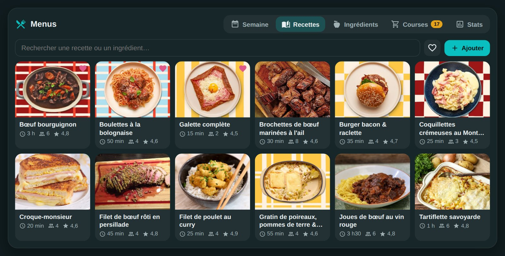

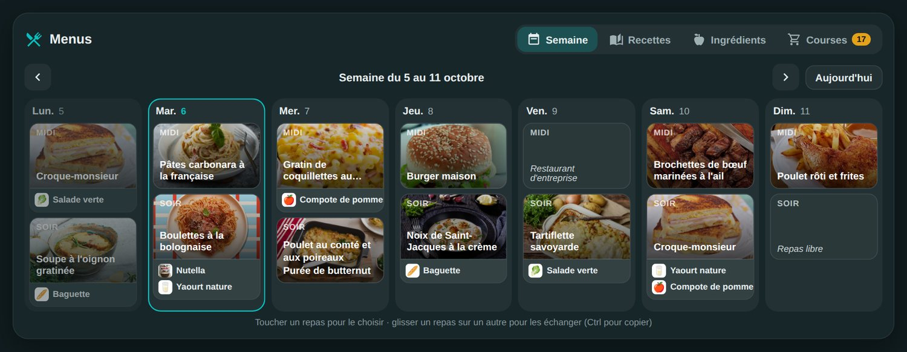

| A recipe | A meal | A product |
|---|---|---|
| 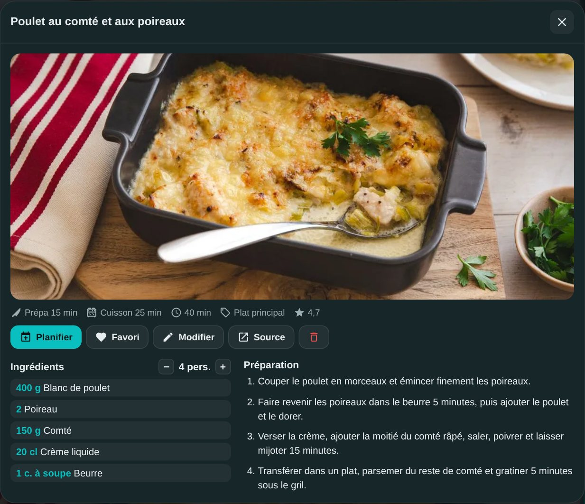 | 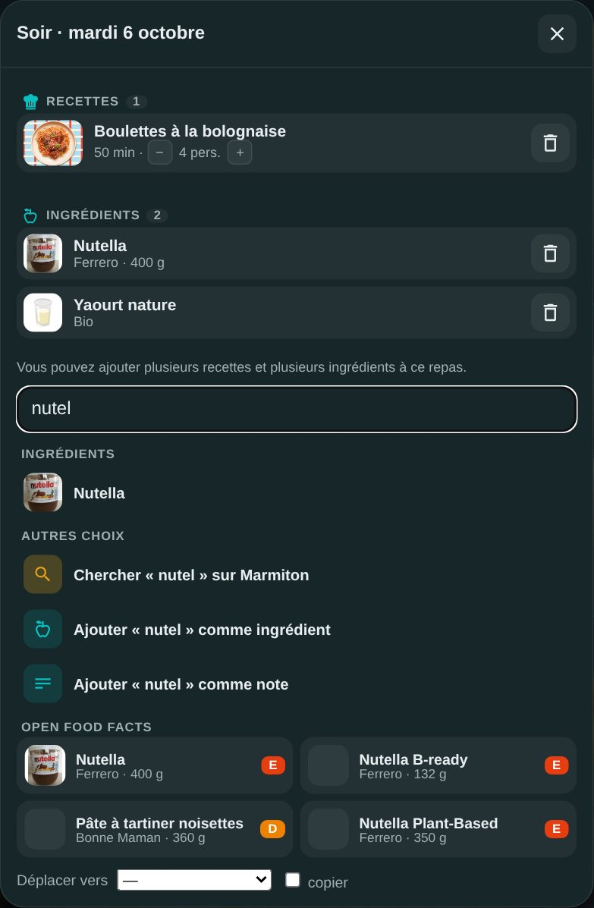 | 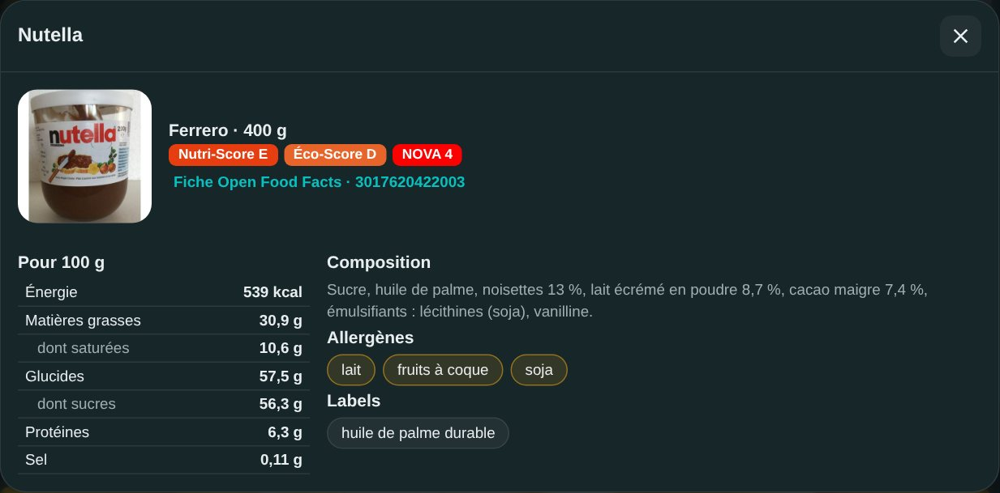 |

### At a glance

- 📅 **Weekly planner**, lunch and dinner:
  - several recipes, ingredients and notes in the same meal (a dish, bread and a yoghurt, for example);
  - drag a meal onto another to swap them, with Ctrl to copy;
  - number of people adjustable meal by meal.
- 📖 **Recipes**:
  - **Marmiton or Jow search**, then pick a result: the recipe is imported with its photo, ingredients and steps;
  - import from **any recipe link** (every site that publishes the schema.org format);
  - import of your **Mealie** recipes, and export to Mealie of recipes found elsewhere (Marmiton, link, PDF, by hand);
  - manual entry, favourites, adjustable servings;
  - **duplicate a recipe** to make a revisited version, without touching the original.
- 🥫 **Ingredients linked to your recipes**:
  - each recipe line is understood ("600 g de bœuf haché" gives 600 g of *Bœuf haché*) and linked to your database;
  - the aisle is guessed automatically.
- 🔎 **Open Food Facts**: a product you don't have yet is found by typing 3 letters. You get:
  - the product photo, saved on your Home Assistant;
  - the brand and packaging;
  - the Nutri-Score, Eco-Score and NOVA;
  - nutrition facts, ingredients list, allergens and labels.
- 🛒 **Shopping list**:
  - generated for the chosen week **or between two dates** (a long weekend from Saturday to Tuesday, for example), with quantities scaled and added up (1 l + 30 cl of milk = 1.3 l);
  - sorted by aisle, with items added by hand and tick boxes for the shop;
  - **e-mail to several people** thanks to the address book, by Telegram and/or as a notification on phones; copy or empty in one tap;
  - grouping of ingredient variants (eggs, bacon bits, butter…), custom categories, temporary exclusions per week and restoring items;
  - interactive Telegram list with tick buttons synced with Home Assistant.
- 📷 **Photos and barcodes**: recipe photo taken with the phone or picked from the gallery; add a product by **scanning its barcode**.
- 📊 **Statistics**: most planned recipes, most used ingredients, meals per week, database size.
- 🖼️ **Four card views**:
  - **Full** to manage everything;
  - **Today's menu** and **Week**, view only, ideal for a wall tablet. A tap on a dish or product shows it full size;
  - **Statistics**.
- 📆 **Export the planner to a Home Assistant calendar**, local or remote (Google Calendar, CalDAV): adds meals, updates existing HOLM events and syncs without duplicates.
- 🔔 **Scheduled reminders**: shopping, menus, recipe prep or a custom message; one-off, daily or weekly, by Home Assistant notification, Telegram or e-mail.
- 📄 **Recipe import from a text PDF**: read locally with `pypdf`, no OCR service or external server. Scanned PDFs without selectable text aren't supported.
- 🧩 **Sensors** for your automations: lunch menu, dinner menu and next meal.

### 🆕 What's new in 1.3.0

- 📅 **Today and the next 6 days** ([#13](https://github.com/kaaribou/holm-mymenu/issues/13)): a button next to "Today" switches the planner from the Monday-to-Sunday week to a view starting today. The choice is remembered by the device; the `week_start: today` option makes it the default.
- ✨ **Suggest meals** ([#15](https://github.com/kaaribou/holm-mymenu/issues/15)): the **Suggest** button of the Week tab fills empty meals with **your own recipes**, without duplicates, avoiding those of the last 14 days and favouring your favourites. Each proposal can be changed with a tap (🎲) or removed before planning. Meals already planned are never replaced.
- 🔍 **Recipe filters**: category, maximum time and minimum rating, in the Recipes tab and in the suggestions (which leave out starters and desserts by default).
- 🚫 **Ingredients to avoid** in suggestions, shared across all your devices. It is a simple filter on ingredient names, not a guarantee: always check the recipe in case of allergy.

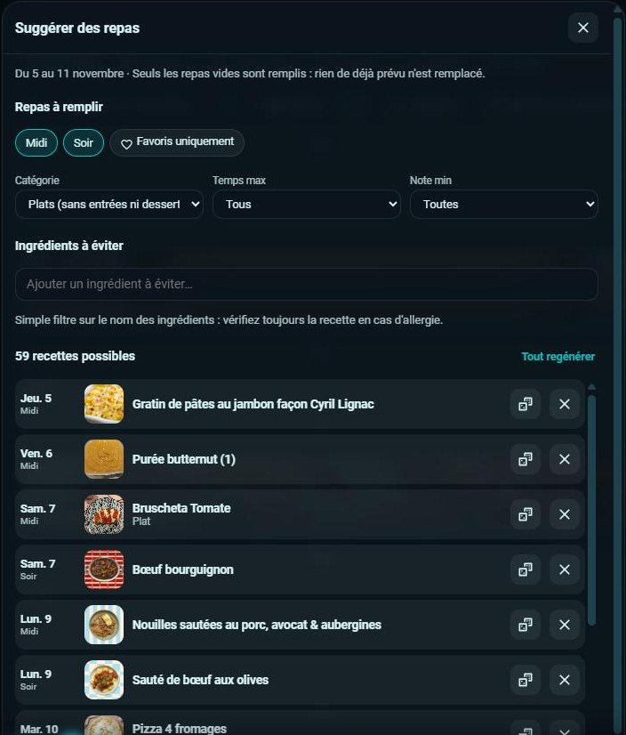

---

## Contents

- [Installation](#installation)
- [Configuration](#configuration)
- [The `holm-mymenu-card` card](#the-holm-mymenu-card-card)
- [Recipes](#recipes)
- [Ingredients and Open Food Facts](#ingredients-and-open-food-facts)
- [Shopping list](#shopping-list)
- [Export to a calendar](#export-to-a-calendar)
- [Reminders and notifications](#reminders-and-notifications)
- [Statistics](#statistics)
- [Sensors](#sensors)
- [FAQ / troubleshooting](#faq--troubleshooting)

---

## Installation

### Via HACS (recommended)

1. HACS → **⋮** menu → **Custom repositories**.
2. Repository: `https://github.com/kaaribou/holm-mymenu`. Type: **Integration**. Click **Add**.
3. Search for **HOLM My Menu** → **Download**.
4. **Restart** Home Assistant.

### Manual

Copy the `custom_components/holm_mymenu` folder into `/config/custom_components/`, then restart Home Assistant.

> The `holm-mymenu-card` card is included: the integration adds it to the Lovelace resources itself and keeps its version up to date. **Nothing to declare by hand.**

---

## Configuration

1. **Settings → Devices & services → Add integration → HOLM My Menu.**
2. Enter the **default number of people**.
3. Optional, in **Configure** (the integration's options):
   - **Mealie address** (e.g. `http://192.168.1.10:9925`) and **Mealie API token** (Mealie → Profile → API tokens), to import your Mealie recipes and send yours there;
   - the default number of people can be changed at any time.

### E-mail notifications: SMTP

To send the shopping list or reminders by e-mail, first set up Home Assistant's [**SMTP** integration](https://www.home-assistant.io/integrations/smtp/). It provides the server, port, credentials and sender; HOLM reuses these settings and lets you pick recipients from its address book.

### Notifications and interactive shopping: Telegram

1. Set up Home Assistant's [**Telegram Bot** integration](https://www.home-assistant.io/integrations/telegram_bot/) with your bot and allow the target chats. HOLM doesn't need a second Telegram token.
2. Check that Home Assistant has the `telegram_bot.send_message` service and that the bot can post in the chosen chat or group.
3. In HOLM's **Shopping** tab, open the list sending window, select the Telegram destination (chat ID and, for a supergroup topic, the thread ID), then post.
4. The message shows categories and quantities; its buttons tick or untick items. Changes are reflected in the HOLM list and posted messages are updated.

### Native Home Assistant notifications

For phone notifications, install the [**Home Assistant companion app**](https://www.home-assistant.io/integrations/mobile_app/) and enable notifications on the device. You can then pick the available notification entities.

Everything is stored locally in Home Assistant (`.storage/holm_mymenu`), and photos in `www/holm_mymenu/`. This folder is created by the integration and its photos are served by the integration itself: nothing to prepare, and they show up even if the `www` folder didn't exist yet.

---

## The `holm-mymenu-card` card

Add a card and search for **HOLM – My Menu**, or in YAML:

```yaml
type: custom:holm-mymenu-card
```

| Option | Values | Default | Purpose |
|---|---|---|---|
| `title` | text | `Menus` | Card title |
| `view` | `full`, `today`, `week`, `stats` | `full` | **Full** (management), **Today's menu** or **Week** (view only), **Statistics** |
| `tab` | `week`, `recipes`, `ingredients`, `shopping`, `stats` | `week` | Tab shown on opening (full view) |
| `today_slots` | `[midi]`, `[soir]`, `[midi, soir]` | both | Meals shown (`midi` = lunch, `soir` = dinner), in every view |
| `week_start` | `monday`, `today` | `monday` | Planner from Monday to Sunday, or starting today (7 days); the card's button switches between them |
| `list_height` | number (px), `0` = no limit | `620` | Height of the recipe and ingredient lists on a computer (on mobile, the page scrolls); more items load as you scroll |
| `show_frame` | `true` / `false` | `true` | Show the card background and frame |
| `language` | `fr` · `en` · `de` · `es` · `it` · `nl` · `pt` · `pl` | profile language | Card language |

All these options can also be set in the visual editor.

### Full view

Tabs: **Week**, **Recipes**, **Ingredients**, **Shopping**, **Reminders** and **Stats**.

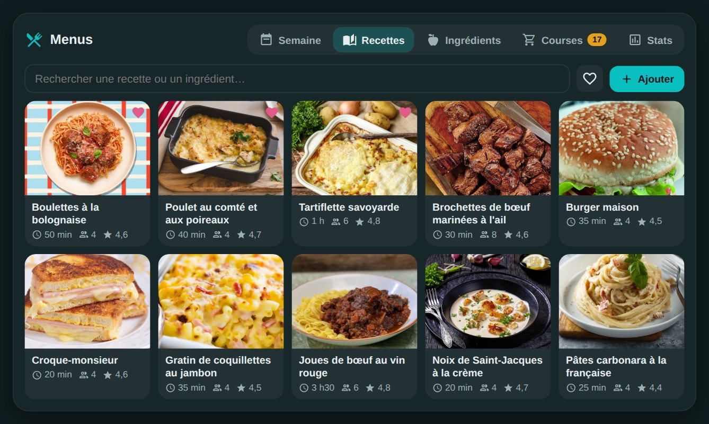

Tap a meal to fill it. The search field offers at the same time:

1. your recipes and ingredients;
2. a Marmiton or Jow search;
3. Open Food Facts products;
4. adding an ingredient or a free note.

In a meal's window, recipes, ingredients and notes are kept apart. A tap opens the details, and the ← arrow takes you back to the meal.

**Suggest** proposes a recipe for each empty meal of the period shown (from today on), picked among your recipes according to the filters (category, time, rating, favourites) and the ingredients to avoid. Change a proposal with 🎲, remove it with ✕, then **Plan**: only empty meals are filled.

### "Today's menu" and "Week" views

View only, with no risk of changes. The recipe photo is at the top, ingredients below with their photo. A tap shows the recipe or product sheet full size.

| Today's menu | Week |
|---|---|
| 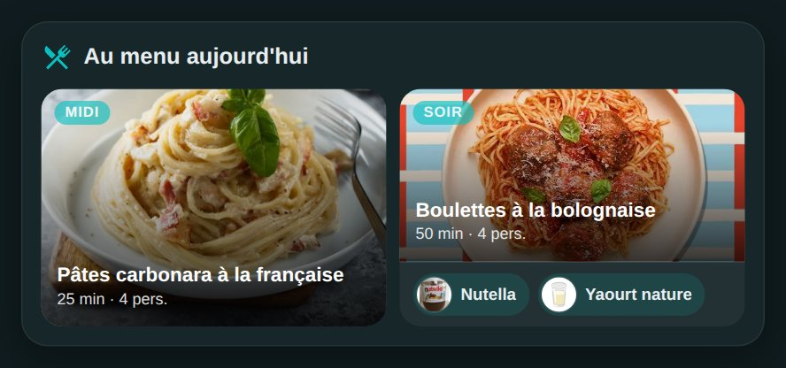 | 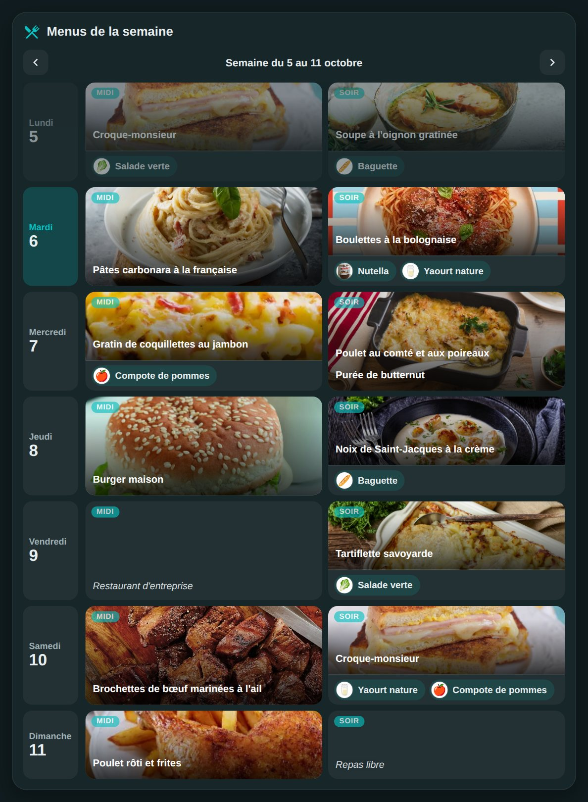 |

```yaml
type: custom:holm-mymenu-card
view: today        # or week
title: On the menu today
today_slots: [soir]
show_frame: false
```

---

## Recipes

**Add** button in the Recipes tab:

- **Search**: choose **Marmiton** or **Jow**, type "lasagnes", pick a result, it's imported. You can switch from one site to the other without retyping the search.
- **Link**: paste the address of a recipe, from Marmiton or any other site that publishes the schema.org format (most cooking sites).
- **Mealie**: tick the recipes to import (address and token in the integration's options). Recipes already imported are flagged.

### Jow recipes

[Jow](https://jow.fr) recipes are imported with their photo, ingredients, steps and times. Jow describes them for one person: HOLM scales the quantities to the integration's default number of people (4 if you haven't changed it).

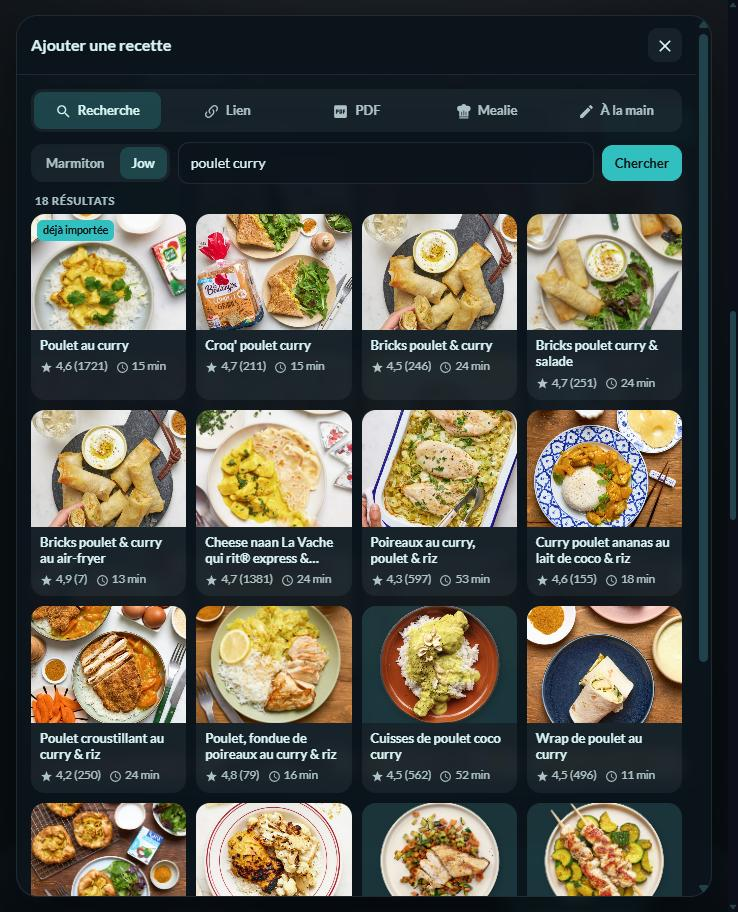

> ⚠️ **Jow has no official API.** The search goes through the public, undocumented interface used by the jow.fr site itself. Jow can change it **at any time and without notice**: the Jow search may then stop working until the next HOLM My Menu update. Recipes already imported aren't affected. The same risk exists, to a lesser extent, for Marmiton's search page.

### Duplicate a recipe

On a recipe's sheet, **Duplicate** creates a full copy (ingredients, steps, times, servings, photo) named "… (revisitée)" and opens it straight away for editing: rename it and adapt it. The original stays untouched, and the copy shows an **Inspired by …** link to it. Meals already planned keep the original recipe.

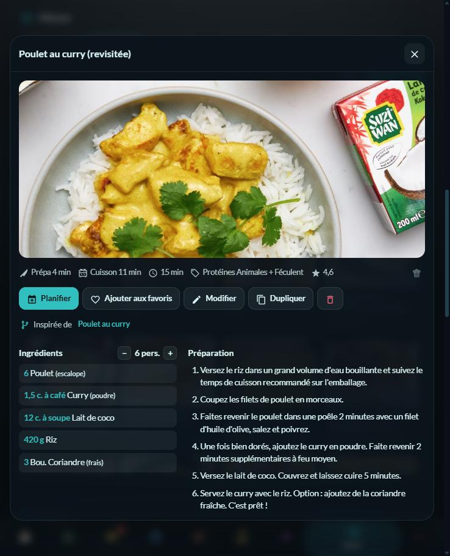

### Send a recipe to Mealie

When the Mealie address and token are filled in, a small discreet chef's hat 👨‍🍳 appears at the end of a recipe's info line (time, category…).

- **Recipe from a web page (Marmiton, link)**: Mealie imports the original page itself, with its photo, steps and times. If the page isn't reachable for Mealie, HOLM sends its own copy of the recipe.
- **PDF or hand-written recipe**: HOLM sends it in the standard `schema.org/Recipe` format, then its photo.
- **No duplicates**: a recipe already sent (or imported from Mealie) carries a green tick; the hat then opens the recipe in Mealie directly.
- The token must be able to create recipes (a personal token can). Exporting hand-written recipes requires **Mealie 2.0 or later**.
- **PDF**: choose a document with selectable text (see the procedure below).
- **By hand**: name, servings, times, one line per ingredient, one line per step, and a **photo**: *Choose a photo* (phone gallery or file) or *Take a photo* with the camera. It's resized before sending and saved on your Home Assistant.

### Import a recipe from a PDF

1. Open the **Full** view, **Recipes** tab, then click **Add** and choose **PDF**.
2. Select a `.pdf` file of **8 MB maximum** and **15 pages maximum**. The document must contain selectable text: an image-only scan doesn't work, because **OCR has been removed**.
3. Let HOLM upload the document in chunks and analyse its text. The recipe form is pre-filled from the recognised information; the **file name** is used as the initial title and an image embedded in the PDF may be offered.
4. Check the title, servings, ingredients and steps, correct them if needed, then **save the recipe**. The analysis doesn't save it automatically.

Uploads are limited to two simultaneous documents per connection; chunks stay temporarily in memory (expiring after 10 minutes of inactivity). The original PDF isn't kept. The image, if any, is only saved with the recipe.

In a recipe's sheet, you can:

- change the number of people: quantities follow;
- plan it on a meal in the next two weeks;
- mark it as a favourite, edit it or open the original recipe;
- tap an ingredient to open its sheet.

---

## Ingredients and Open Food Facts

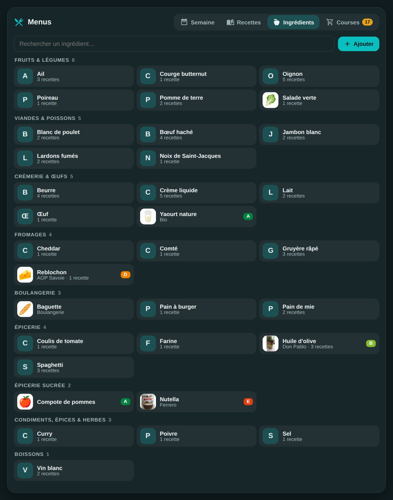

- Ingredients are created automatically when recipes are imported, without duplicates ("oignons" and "oignon" give the same ingredient).
- **Add** searches your database and Open Food Facts. Pick a product: its full sheet and photo are saved.
- **Scan** reads a product's barcode with the phone's camera; you can also photograph the code or type its number (directly in the search, e.g. `3017620422003`). The Open Food Facts sheet appears, a tap adds it.
  - On iPhone and iPad, reading uses a small library loaded from the Internet at scan time.
- In an ingredient's sheet, you can:
  - edit the name, aisle, brand, packaging and a note;
  - choose or take a photo;
  - link an Open Food Facts product, or change it;
  - see the recipes that use it.

---

## Shopping list

| The list | Sending |
|---|---|
| 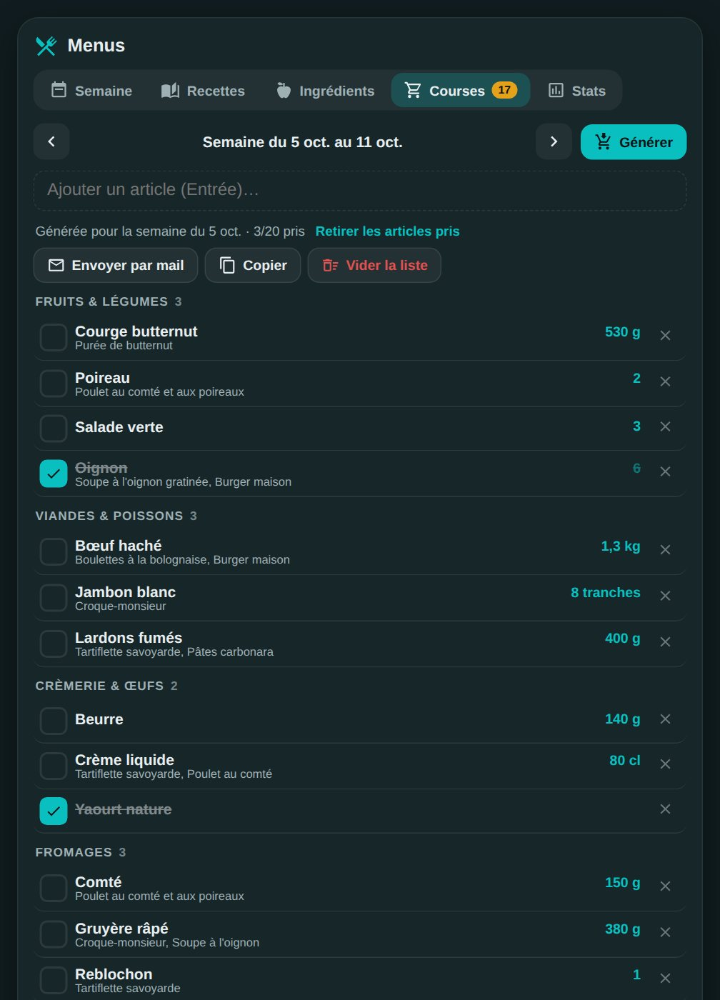 | 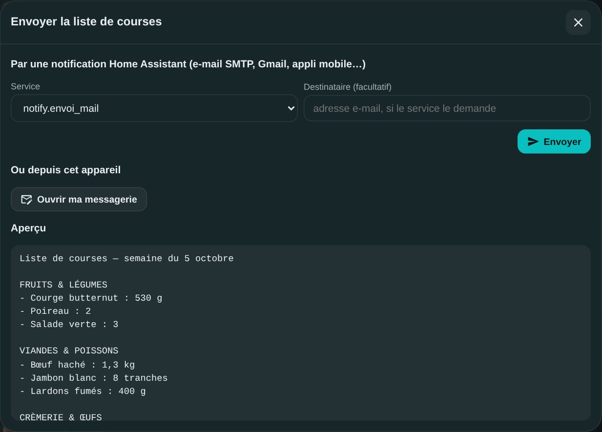 |

- Choose the week and tap **Generate**: the ingredients of the planned meals are scaled to the number of people, added up and sorted by aisle.
- **Shopping over several days, across two weeks**: switch from **Week** to **Dates**, choose **From** and **To** (31 days maximum), then **Generate**. The chosen period ("from Sat, Oct 31 to Tue, Nov 3") is shown in the list and in every message: e-mail, Telegram, notifications and reminders.
- From an automation, the `holm_mymenu.generate_shopping_list` action generates the list for the current week, or for the given dates (`start`, `end`).
- Items already ticked and those added by hand are kept when you regenerate the list.
- **Send** opens the sending window:
  - an **address book** (Mary, Paul, Leah…): tick people, add or remove them; your choices are remembered for next time;
  - **a single e-mail** goes to all ticked addresses, laid out by aisle with a tick box per item. It uses your Home Assistant **SMTP** integration settings (server, credentials, sender): nothing to retype, and no address to declare as an SMTP recipient;
  - **phones and tablets** (notification entities) can be ticked too: they receive the list as a notification;
  - **Open my mail app** prepares the same message in the device's mail app, with the ticked addresses.
- Similar items are grouped for display without losing the original entries: for example **œuf/œufs** (egg/eggs), **lardon/lardons** (bacon bits) and **beurre/beurre doux** (butter/unsalted butter). Compatible quantities are added up.
- You can **customise categories**, edit or remove an item from the list without deleting the ingredient from its recipe, and **exclude items for a period** then restore them one by one or all together.
- **Telegram** sending offers an interactive list, synced with the tick boxes in HOLM. The message keeps the aisles, quantities and dates of the shopping period. Long lists are split over several messages; buttons act on all grouped items and existing messages are refreshed when the list changes.
- **Copy** puts the list on the clipboard. **Empty the list** starts from scratch.

---

## Export to a calendar

The HOLM planner can be **exported manually** to a calendar already set up in Home Assistant: a local calendar, **Google Calendar** or a remote **CalDAV** calendar. HOLM uses the `calendar.*` entity provided by the calendar integration; it doesn't ask for a Google account or extra CalDAV credentials.

### Prepare the calendar

1. Add the integration matching your calendar: [**Local Calendar**](https://www.home-assistant.io/integrations/local_calendar/), [**Google Calendar**](https://www.home-assistant.io/integrations/google/) or [**CalDAV**](https://www.home-assistant.io/integrations/caldav/).
2. Check that the target calendar appears as a `calendar.*` entity in Home Assistant and that it allows creating events.
3. In HOLM My Menu, open the planner and the **calendar export**. Choose the target calendar, the period and, if you like, a prefix for the titles.

### How the export works

- HOLM creates **one event per meal** (lunch or dinner) containing the planned recipes and, when they exist, their original URLs.
- Current times: **12:00–13:00** for lunch and **19:00–20:00** for dinner, in Home Assistant's time zone.
- The selected period can cover **32 days maximum**.
- **Only add missing events**: keeps HOLM events already present and only adds the missing ones.
- **Sync**: creates missing events, updates those that changed and can delete HOLM events that are no longer needed, **only after confirmation**.
- Created events carry a HOLM ID in their description: syncing doesn't alter the calendar's other appointments.

> Updating and deleting depend on the features supported by the chosen calendar integration. If they're unavailable, HOLM reports that it can't sync instead of creating duplicate events. The export is **triggered by the user**; it isn't a permanent automatic sync nor a two-way import of appointments.

---

## Reminders and notifications

HOLM lets you schedule reminders to **do the shopping**, **check the menus**, **prepare a recipe** or send a **custom message** (for example "Buy potatoes at the farm").

- **Frequency**: once (specific date), every day or every week, with a choice of time and, for weekly reminders, days. Times use Home Assistant's time zone.
- **Channels**: Home Assistant notification on a phone, Telegram (chat or topic) and e-mail via SMTP. Several recipients can be selected.
- **Shopping**: the reminder and the messages sent mention the period of the selected list.
- **Management**: create, edit, delete and test a reminder from the HOLM interface.
- **Triggering**: checked every 30 seconds; a scheduled reminder is sent only once per scheduled minute, including after a restart. If it fails, the status shows the error but sending isn't automatically retried during that minute.
- **"Only send if needed" condition**: for shopping, no reminder if no item is pending; for the planner, no reminder if all meals of the next seven days are planned. Prep reminders remain manually entered instructions.
- **Telegram**: reminders are messages separate from the interactive shopping list. A supergroup topic can be targeted with its thread ID.

Channel settings are those of Home Assistant's [SMTP](https://www.home-assistant.io/integrations/smtp/), [Telegram Bot](https://www.home-assistant.io/integrations/telegram_bot/) and [Mobile App](https://www.home-assistant.io/integrations/mobile_app/) integrations: HOLM doesn't store an extra SMTP password or Telegram token.

---

## Statistics

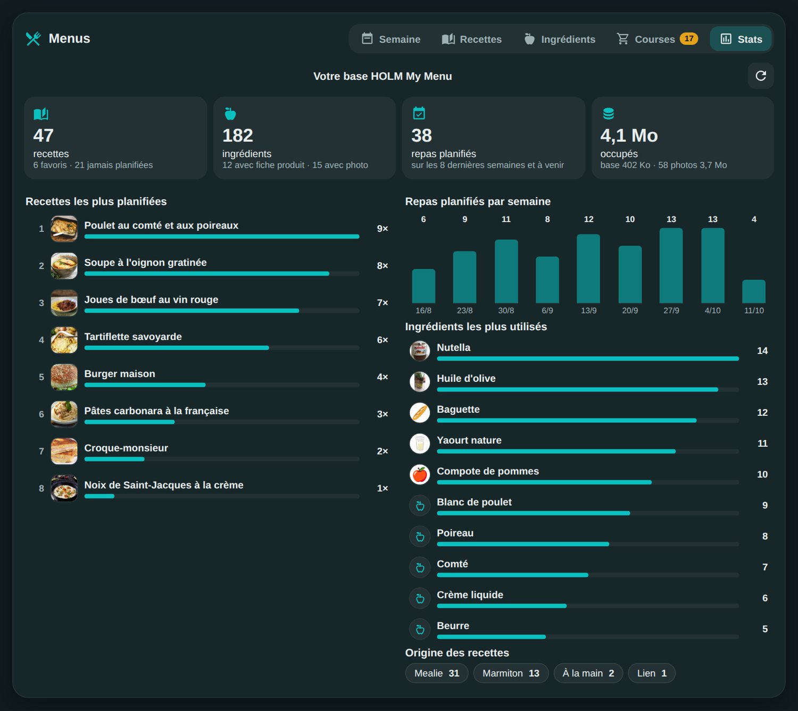

The **Stats** tab (or a dedicated card with `view: stats`) shows:

- key figures: recipes (favourites, never planned), ingredients (with product sheet, with photo), meals planned, space used by the database and photos;
- the **most planned recipes**, with the number of times and the last date; a tap opens the recipe;
- the **most used ingredients** (based on planned recipes);
- **meals planned per week** over the last 8 weeks;
- recipe sources (Marmiton, Jow, Mealie, link, revisited, by hand).

The counter is kept forever, even when the planner history is cleaned up.

```yaml
type: custom:holm-mymenu-card
view: stats
title: Our habits
```

---

## Sensors

| Entity | State | Attributes |
|---|---|---|
| `sensor.holm_mymenu_midi` | lunch menu | `date`, `slot`, `recipes` (name, duration, servings), `entries` |
| `sensor.holm_mymenu_soir` | dinner menu | same |
| `sensor.holm_mymenu_next` | next planned meal | same |

The entity picture is the recipe photo. Example: announce the dinner menu on the kitchen speaker. When nothing is planned, the state is `Rien de prévu`.

```yaml
automation:
  - alias: Dinner menu announcement
    triggers:
      - trigger: time
        at: "18:30:00"
    conditions:
      - condition: not
        conditions:
          - condition: state
            entity_id: sensor.holm_mymenu_soir
            state: Rien de prévu
    actions:
      - action: tts.speak
        target:
          entity_id: tts.google_translate_en_com
        data:
          media_player_entity_id: media_player.kitchen
          message: "Tonight's menu: {{ states('sensor.holm_mymenu_soir') }}"
```

---

## FAQ / troubleshooting

**"Custom element doesn't exist: holm-mymenu-card".**
Check in *Settings → Dashboards → ⋮ → Resources* that `/holm_mymenu_static/holm-mymenu-card.js` is listed (the integration adds it at startup; in YAML mode, add it yourself as a *module*). Then reload with **Ctrl + Shift + R**. In the mobile app: Settings → Companion app → Debugging → **Reset frontend cache**.

**The Open Food Facts search doesn't respond.**
Open Food Facts is a free service, sometimes overloaded. Try again a bit later. You can also add the ingredient without a product and link it later from its sheet.

**A Marmiton recipe won't import.**
Marmiton may change its page. Try the **Link** import; otherwise, open an issue with the recipe's address.

**The Jow search no longer responds.**
Jow has no official API and may change its own without notice (see [Jow recipes](#jow-recipes)). Try the **Link** import with the address of a jow.fr recipe, and open an issue: the search will be adapted.

**The calendar export refuses an update or a deletion.**
The target calendar must allow the requested operation. Try the "only add missing events" mode or check the calendar's permissions in Home Assistant. Deleting old HOLM events requires explicit confirmation.

**A scanned PDF won't import.**
HOLM reads PDFs that contain usable text. OCR has been removed: first convert the scan to a PDF with selectable text. Also check the **8 MB and 15 pages** limits, then review the draft recipe before saving.

**Telegram doesn't send the list or the buttons don't respond.**
Check the [Telegram Bot](https://www.home-assistant.io/integrations/telegram_bot/) integration, the allowed chats, the bot's rights in the group and, if relevant, the topic ID. The `telegram_bot.send_message` service must be available.

**E-mail sending fails.**
Sending uses Home Assistant's **SMTP** integration: check that it's set up and working. For Gmail, you need an *app password*. Without an SMTP integration, use "Open my mail app".

**The scanner won't open.**
The browser must be allowed to use the camera, and Home Assistant must be opened over HTTPS. Otherwise, *Photograph the code* or type its number.

**Mobile: on the first photo, the app goes back to the Home Assistant home page.**
The Home Assistant app reloads after asking for camera permission. Choose "While using the app": the question won't come back, and you just need to reopen the menus page that one time.

**Mealie: "Mealie token refused".**
Create a new token in Mealie (Profile → API tokens) and paste it into the integration's options.

**Are photos stored at home?**
Yes. Recipe and product photos are copied into `www/holm_mymenu/`: the card doesn't depend on external sites to display them.

> Product data: [Open Food Facts](https://world.openfoodfacts.org) (ODbL licence). Recipes: [Marmiton](https://www.marmiton.org), [Jow](https://jow.fr) (not affiliated, unofficial interface) and the original sites, for personal use; [Mealie](https://mealie.io) for import and export.

---

## Say thanks?

Like the integration? You can buy me a beer 🍺

[](https://paypal.me/kaaribou)

---

## License

Code: **MIT** license — © kaaribou. See the [CHANGELOG](CHANGELOG.md) (in French).

Part of **HOLM — Home Orchestration & Living Management**: smart management and orchestration of the home.

Other projects: [Volets HOLM](https://github.com/kaaribou/volets-holm) · [Climat HOLM](https://github.com/kaaribou/climat-holm) · [Carburant HOLM](https://github.com/kaaribou/carburant-holm) · [HOLM LaMetric](https://github.com/kaaribou/lametric-holm) · [HOLM Lektrico](https://github.com/kaaribou/lektrico-holm) · [HOLM HP/HC](https://github.com/kaaribou/holm-tarif) · [HOLM GitHub](https://github.com/kaaribou/github-holm) · [HOLM Cars](https://github.com/kaaribou/holm-cars) · [HOLM Navbar Card](https://github.com/kaaribou/holm-navbar-card) · [HOLM Climate Card](https://github.com/kaaribou/climate-card-holm) · [HOLM Music Card](https://github.com/kaaribou/holm-music-card) · [HOLM Sentinel Card](https://github.com/kaaribou/holm-sentinel-card) · [HOLM Security Card](https://github.com/kaaribou/holm-security-card) · [HOLM Recordings Card](https://github.com/kaaribou/holm-recordings-card) · [HOLM Covers Card](https://github.com/kaaribou/holm-covers-card) · [HOLM Runtime Card](https://github.com/kaaribou/holm-runtime-card) · [HOLM Power Flow Card](https://github.com/kaaribou/holm-power-flow-card) · [HOLM Energy Cards](https://github.com/kaaribou/holm-energy-cards) · [HOLM Radiator Card](https://github.com/kaaribou/holm-radiator-card) · [HOLM Floor Card](https://github.com/kaaribou/holm-floor-card) · [HOLM Ecojoko Card](https://github.com/kaaribou/holm-ecojoko-card) · [HOLM Smoke Card](https://github.com/kaaribou/holm-smoke-card) · [HOLM Family Card](https://github.com/kaaribou/holm-family-card) · [HOLM Live Power Card](https://github.com/kaaribou/holm-live-power-card) · [HOLM Solar Optimizer Card](https://github.com/kaaribou/holm-solar-optimizer-card) · [HOLM Govee Light Card](https://github.com/kaaribou/holm-govee-light-card) · [HOLM Leapmotor Card](https://github.com/kaaribou/holm-leapmotor-card).
