# 🍽️ HOLM My Menu

[](https://hacs.xyz/)


**Les menus de la semaine, vos recettes et la liste de courses, directement dans Home Assistant.**

HOLM My Menu est une intégration **Home Assistant** pensée comme un Mealie en plus simple. Vous gardez vos recettes, vous planifiez le midi et le soir, et la liste de courses se fait toute seule. Les recettes viennent de **Marmiton**, de **Jow**, d'un simple lien ou de votre **Mealie**. Les produits viennent d'**Open Food Facts**, avec leur photo et leur fiche complète.

> ✨ **Une seule carte pour tout faire, zéro YAML.** La carte est fournie par l'intégration : aucune ressource Lovelace à ajouter.

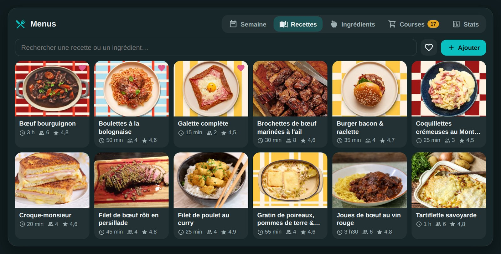

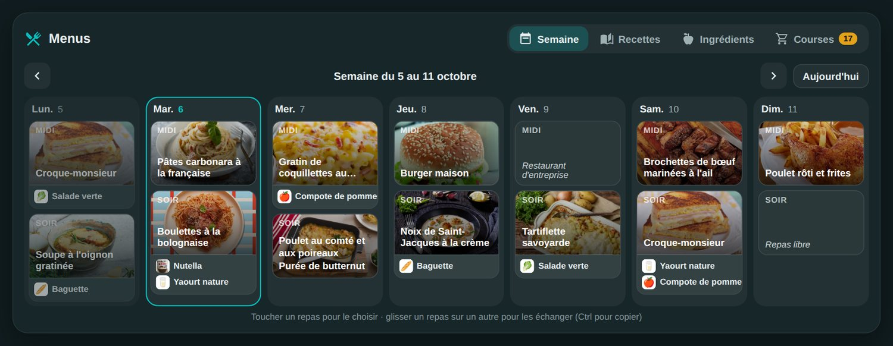

| Une recette | Un repas | Un produit |
|---|---|---|
| 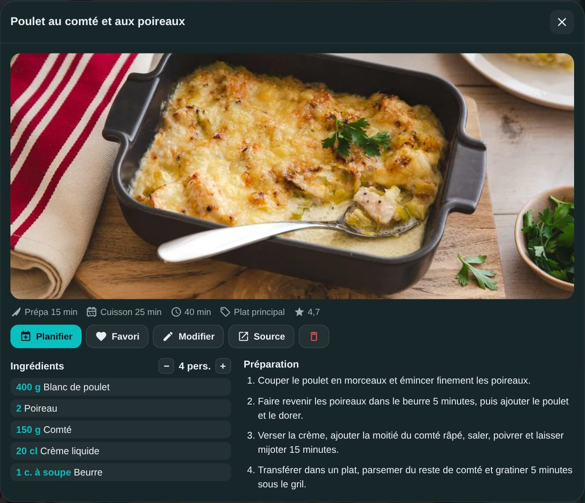 | 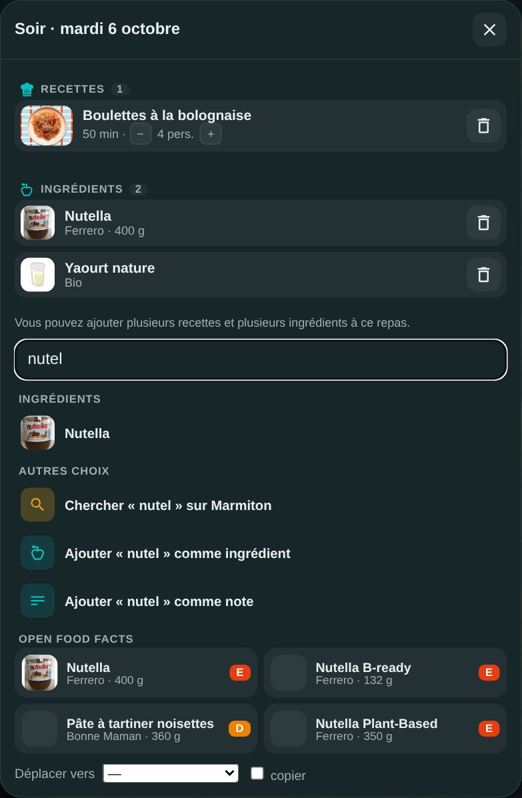 | 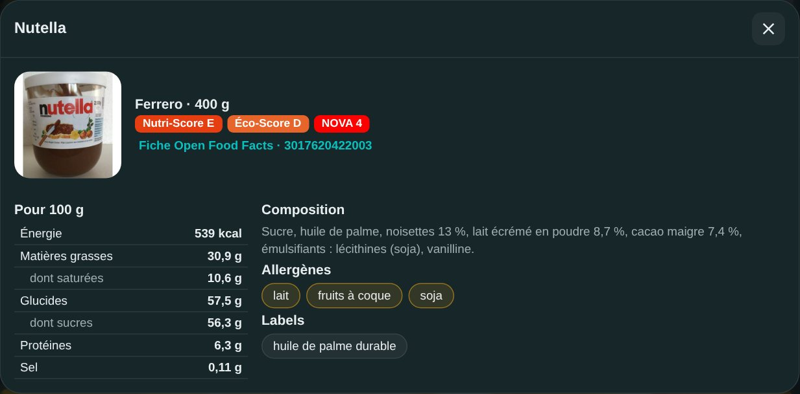 |

### En bref

- 📅 **Planning de la semaine**, midi et soir :
  - plusieurs recettes, ingrédients et notes dans un même repas (un plat, du pain et un yaourt, par exemple) ;
  - glisser un repas sur un autre pour les échanger, avec Ctrl pour copier ;
  - nombre de personnes réglable repas par repas.
- 📖 **Recettes** :
  - **recherche Marmiton ou Jow**, puis choix du résultat : la recette est importée avec sa photo, ses ingrédients et ses étapes ;
  - import depuis **n'importe quel lien** de recette (tous les sites qui publient le format schema.org) ;
  - import de vos recettes **Mealie**, et export vers Mealie des recettes trouvées ailleurs (Marmiton, lien, PDF, à la main) ;
  - saisie à la main, favoris, portions ajustables ;
  - **dupliquer une recette** pour en faire une version revisitée, sans toucher à l'original.
- 🥫 **Ingrédients reliés à vos recettes** :
  - chaque ligne d'une recette est comprise (« 600 g de bœuf haché » donne 600 g de *Bœuf haché*) et reliée à votre base ;
  - le rayon est deviné automatiquement.
- 🔎 **Open Food Facts** : un produit que vous n'avez pas encore se cherche en tapant 3 lettres. Vous obtenez :
  - la photo du produit, enregistrée sur votre Home Assistant ;
  - la marque et le conditionnement ;
  - le Nutri-Score, l'Éco-Score et NOVA ;
  - les valeurs nutritionnelles, la composition, les allergènes et les labels.
- 🛒 **Liste de courses** :
  - générée depuis la semaine choisie, avec les quantités mises à l'échelle et additionnées (1 l + 30 cl de lait = 1,3 l) ;
  - rangée par rayon, avec des articles ajoutés à la main et des cases à cocher en magasin ;
  - **envoi par e-mail à plusieurs personnes** grâce au carnet d'adresses, par Telegram et/ou en notification sur les téléphones ; copie ou vidage en un geste ;
  - regroupement des variantes d'ingrédients (œufs, lardons, beurre doux…), catégories personnalisées, exclusions temporaires par semaine et restauration des articles ;
  - liste Telegram interactive avec boutons de validation synchronisés avec Home Assistant.
- 📷 **Photos et code-barre** : photo d'une recette prise avec le téléphone ou choisie dans la galerie ; ajout d'un produit en **scannant son code-barre**.
- 📊 **Statistiques** : recettes les plus planifiées, ingrédients les plus utilisés, repas par semaine, taille de la base.
- 🖼️ **Quatre vues pour la carte** :
  - **Complet** pour tout gérer ;
  - **Menu du jour** et **Semaine** en simple consultation, idéales pour une tablette murale. Un toucher sur un plat ou un produit l'affiche en grand ;
  - **Statistiques**.
- 📆 **Export du planning vers un calendrier Home Assistant**, local ou distant (Google Calendar, CalDAV) : ajout des repas, mise à jour des événements HOLM existants et synchronisation sans doublons.
- 🔔 **Rappels programmables** : courses, menus, préparation des recettes ou message personnalisé ; envoi ponctuel, quotidien ou hebdomadaire par notification Home Assistant, Telegram ou e-mail.
- 📄 **Import de recettes depuis un PDF texte** : lecture locale avec `pypdf`, sans service OCR ni serveur externe. Les PDF scannés sans texte sélectionnable ne sont pas pris en charge.
- 🧩 **Capteurs** pour vos automatisations : menu du midi, menu du soir et prochain repas.

---

## Sommaire

- [Installation](#installation)
- [Configuration](#configuration)
- [La carte `holm-mymenu-card`](#la-carte-holm-mymenu-card)
- [Recettes](#recettes)
- [Ingrédients et Open Food Facts](#ingrédients-et-open-food-facts)
- [Liste de courses](#liste-de-courses)
- [Export vers un calendrier](#export-vers-un-calendrier)
- [Rappels et notifications](#rappels-et-notifications)
- [Statistiques](#statistiques)
- [Capteurs](#capteurs)
- [FAQ / dépannage](#faq--dépannage)
- [Crédits & licence](#crédits--licence)

---

## Installation

### Via HACS (recommandé)

1. HACS → menu **⋮** → **Dépôts personnalisés**.
2. Dépôt : `https://github.com/kaaribou/holm-mymenu`. Type : **Intégration**. Cliquez sur **Ajouter**.
3. Recherchez **HOLM My Menu** → **Télécharger**.
4. **Redémarrez** Home Assistant.

### Manuelle

Copiez le dossier `custom_components/holm_mymenu` dans `/config/custom_components/`, puis redémarrez Home Assistant.

> La carte `holm-mymenu-card` est incluse : l'intégration l'ajoute elle-même aux ressources Lovelace et met sa version à jour. **Rien à déclarer à la main.**

---

## Configuration

1. **Paramètres → Appareils et services → Ajouter une intégration → HOLM My Menu.**
2. Indiquez le **nombre de personnes par défaut**.
3. Facultatif, dans **Configurer** (les options de l'intégration) :
   - **Adresse de Mealie** (ex. `http://192.168.1.10:9925`) et **jeton d'API Mealie** (Mealie → Profil → Jetons d'API), pour importer vos recettes Mealie et y envoyer les vôtres ;
   - le nombre de personnes par défaut peut être changé à tout moment.

### Notifications par e-mail : SMTP

Pour envoyer la liste de courses ou les rappels par e-mail, configurez d'abord l'intégration [**SMTP** de Home Assistant](https://www.home-assistant.io/integrations/smtp/). Elle fournit le serveur, le port, les identifiants et l'expéditeur ; HOLM réutilise ces réglages et permet de choisir les destinataires dans son carnet d'adresses.

### Notifications et courses interactives : Telegram

1. Configurez l'intégration [**Telegram Bot** de Home Assistant](https://www.home-assistant.io/integrations/telegram_bot/) avec votre bot et autorisez les discussions (chats) destinataires. HOLM n'a pas besoin d'un deuxième jeton Telegram.
2. Vérifiez que Home Assistant dispose du service `telegram_bot.send_message` et que le bot peut publier dans le chat ou le groupe choisi.
3. Dans l'onglet **Courses** de HOLM, ouvrez l'envoi de la liste, sélectionnez la destination Telegram (identifiant du chat et, pour un sujet de supergroupe, identifiant du fil), puis publiez.
4. Le message affiche les catégories et les quantités ; ses boutons permettent de cocher ou décocher les articles. Les changements sont répercutés dans la liste HOLM et les messages publiés sont mis à jour.

### Notifications natives Home Assistant 
Pour les notifications sur téléphone, installez l'[**application compagnon Home Assistant**](https://www.home-assistant.io/integrations/mobile_app/) et activez les notifications de l'appareil. Vous pourrez ensuite sélectionner les entités de notification disponibles.

Tout est stocké localement dans Home Assistant (`.storage/holm_mymenu`), et les photos dans `www/holm_mymenu/`. Ce dossier est créé par l'intégration et ses photos sont servies par elle-même : rien à préparer, et elles s'affichent même si le dossier `www` n'existait pas encore.

---

## La carte `holm-mymenu-card`

Ajoutez une carte et cherchez **HOLM – My Menu**, ou en YAML :

```yaml
type: custom:holm-mymenu-card
```

| Option | Valeurs | Par défaut | Rôle |
|---|---|---|---|
| `title` | texte | `Menus` | Titre de la carte |
| `view` | `full`, `today`, `week`, `stats` | `full` | **Complet** (gestion), **Menu du jour** ou **Semaine** (consultation), **Statistiques** |
| `tab` | `week`, `recipes`, `ingredients`, `shopping`, `stats` | `week` | Onglet affiché à l'ouverture (vue complète) |
| `today_slots` | `[midi]`, `[soir]`, `[midi, soir]` | les deux | Repas affichés, dans toutes les vues |
| `list_height` | nombre (px), `0` = sans limite | `620` | Hauteur des listes de recettes et d'ingrédients sur ordinateur (sur mobile, c'est la page qui défile) ; la suite se charge au fil du défilement |
| `show_frame` | `true` / `false` | `true` | Afficher le fond et le cadre de la carte |

Toutes ces options se règlent aussi dans l'éditeur visuel.

### Vue complète

Cinq onglets : **Semaine**, **Recettes**, **Ingrédients**, **Courses** et **Stats**.

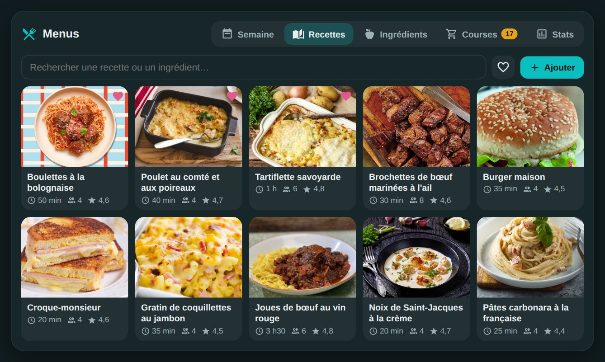

Touchez un repas pour le remplir. Le champ de recherche propose en même temps :

1. vos recettes et vos ingrédients ;
2. une recherche Marmiton ou Jow ;
3. des produits Open Food Facts ;
4. l'ajout d'un ingrédient ou d'une note libre.

Dans la fenêtre d'un repas, les recettes, les ingrédients et les notes sont séparés. Un toucher ouvre le détail, et la flèche ← ramène au repas.

### Vues « Menu du jour » et « Semaine »

En simple consultation, sans risque de modification. La photo de la recette est en haut, les ingrédients en dessous avec leur photo. Un toucher affiche la recette ou la fiche produit en grand.

| Menu du jour | Semaine |
|---|---|
| 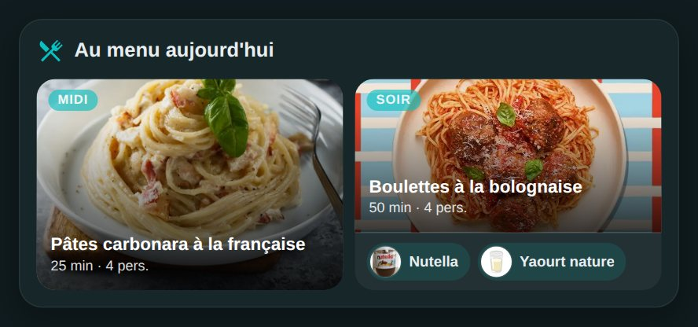 | 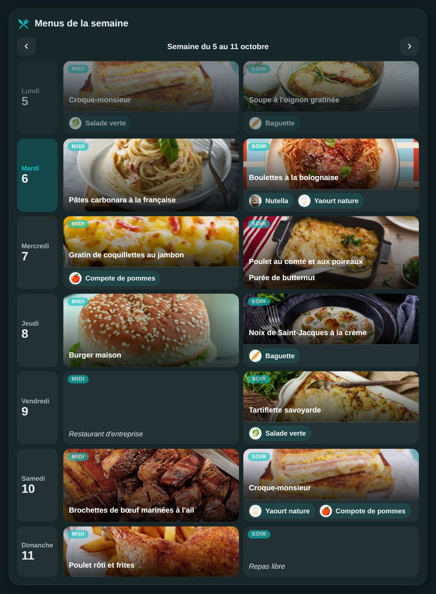 |

```yaml
type: custom:holm-mymenu-card
view: today        # ou week
title: Au menu aujourd'hui
today_slots: [soir]
show_frame: false
```

---

## Recettes

Bouton **Ajouter** de l'onglet Recettes :

- **Recherche** : choisissez **Marmiton** ou **Jow**, tapez « lasagnes », choisissez un résultat, c'est importé. Vous pouvez passer d'un site à l'autre sans retaper la recherche.
- **Lien** : collez l'adresse d'une recette, de Marmiton ou d'un autre site qui publie le format schema.org (la plupart des sites de cuisine).
- **Mealie** : cochez les recettes à importer (adresse et jeton dans les options de l'intégration). Les recettes déjà importées sont signalées.

### Recettes Jow

Les recettes [Jow](https://jow.fr) sont importées avec leur photo, leurs ingrédients, leurs étapes et leurs temps. Jow les décrit pour une personne : HOLM ramène les quantités au nombre de personnes par défaut de l'intégration (4 si vous ne l'avez pas changé).

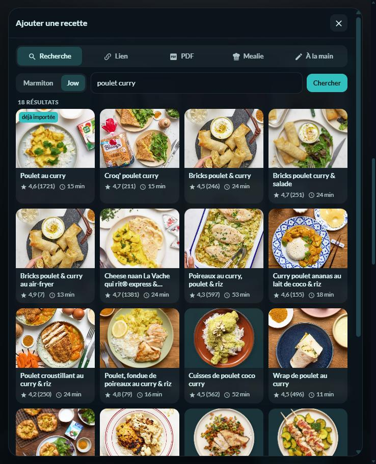

> ⚠️ **Jow ne propose pas d'API officielle.** La recherche passe par l'interface publique, non documentée, qu'utilise le site jow.fr lui-même. Jow peut la modifier **à tout moment et sans prévenir** : la recherche Jow peut alors cesser de fonctionner jusqu'à la mise à jour suivante de HOLM My Menu. Vos recettes déjà importées, elles, ne sont pas touchées. Le même risque existe, à moindre échelle, pour la page de recherche Marmiton.

### Dupliquer une recette

Sur la fiche d'une recette, **Dupliquer** crée une copie complète (ingrédients, étapes, temps, portions, photo) nommée « … (revisitée) » et l'ouvre aussitôt en modification : renommez-la et adaptez-la. L'original reste intact, et la copie affiche un lien **Inspirée de …** vers lui. Les repas déjà planifiés gardent la recette d'origine.

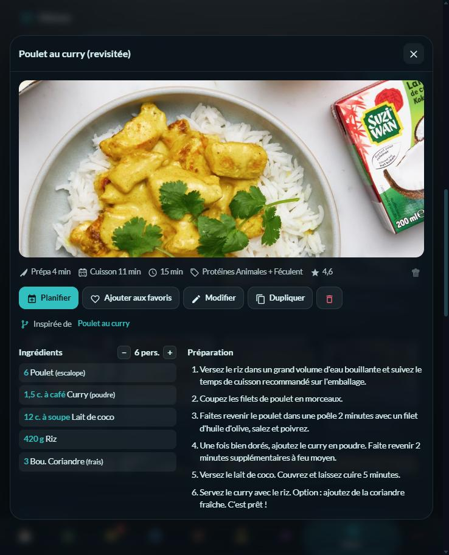

### Envoyer une recette vers Mealie

Quand l'adresse et le jeton Mealie sont renseignés, une petite toque 👨‍🍳 discrète apparaît au bout de la ligne d'informations d'une recette (temps, catégorie…).

- **Recette venue d'une page web (Marmiton, lien)** : Mealie importe lui-même la page d'origine, avec sa photo, ses étapes et ses temps. Si la page lui est inaccessible, HOLM lui envoie sa propre copie de la recette.
- **Recette PDF ou saisie à la main** : HOLM l'envoie au format standard `schema.org/Recipe`, puis sa photo.
- **Pas de doublon** : une recette déjà envoyée (ou importée de Mealie) porte une coche verte ; la toque ouvre alors directement la recette dans Mealie.
- Le jeton doit pouvoir créer des recettes (c'est le cas d'un jeton personnel). L'export de recettes saisies à la main nécessite **Mealie 2.0 ou plus récent**.
- **PDF** : choisissez un document contenant du texte sélectionnable (voir la procédure ci-dessous).
- **À la main** : nom, portions, temps, une ligne par ingrédient, une ligne par étape, et une **photo** : *Choisir une photo* (galerie du téléphone ou fichier) ou *Prendre une photo* avec l'appareil. Elle est réduite avant l'envoi et enregistrée sur votre Home Assistant.

### Importer une recette depuis un PDF

1. Ouvrez la vue **Complet**, onglet **Recettes**, puis cliquez sur **Ajouter** et choisissez **PDF**.
2. Sélectionnez un fichier `.pdf` de **8 Mo maximum** et **15 pages maximum**. Le document doit contenir du texte sélectionnable : un scan constitué uniquement d’images ne fonctionne pas, car **l’OCR a été supprimé**.
3. Laissez HOLM transférer le document par fragments et analyser son texte. Le formulaire de recette est prérempli à partir des informations reconnues ; le **nom du fichier** sert de titre initial et une illustration intégrée au PDF peut être proposée.
4. Vérifiez le titre, les portions, les ingrédients et les étapes, corrigez-les si nécessaire, puis **enregistrez la recette**. L’analyse ne l’enregistre pas automatiquement.

Le transfert est limité à deux documents simultanés par connexion ; les fragments restent temporairement en mémoire (expiration après 10 minutes d’inactivité). Le PDF original n’est pas conservé. L’image éventuelle n’est enregistrée qu’avec la recette.

Dans la fiche d'une recette, vous pouvez :

- changer le nombre de personnes : les quantités suivent ;
- la planifier sur un repas des deux prochaines semaines ;
- la mettre en favori, la modifier ou ouvrir la recette d'origine ;
- toucher un ingrédient pour ouvrir sa fiche.

---

## Ingrédients et Open Food Facts

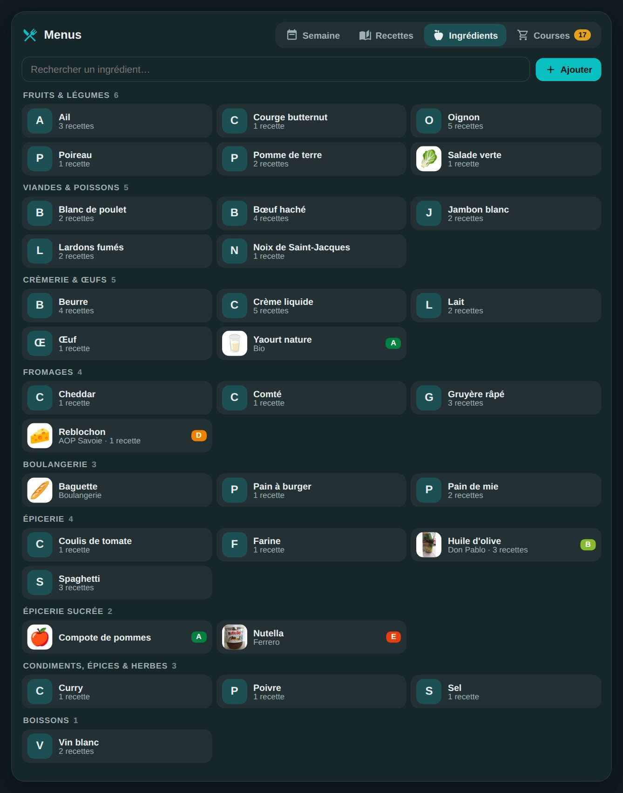

- Les ingrédients sont créés automatiquement à l'import des recettes, sans doublon (« oignons » et « oignon » donnent le même ingrédient).
- **Ajouter** cherche dans votre base et sur Open Food Facts. Choisissez un produit : sa fiche complète et sa photo sont enregistrées.
- **Scanner** lit le code-barre d'un produit avec la caméra du téléphone ; vous pouvez aussi photographier le code ou taper son numéro (directement dans la recherche, par exemple `3017620422003`). La fiche Open Food Facts s'affiche, un toucher l'ajoute.
  - Sur iPhone et iPad, la lecture passe par une petite bibliothèque chargée depuis Internet au moment du scan.
- Dans la fiche d'un ingrédient, vous pouvez :
  - modifier le nom, le rayon, la marque, le conditionnement et une note ;
  - choisir ou prendre une photo ;
  - associer un produit Open Food Facts, ou en changer ;
  - voir les recettes qui l'utilisent.

---

## Liste de courses

| La liste | L'envoi |
|---|---|
| 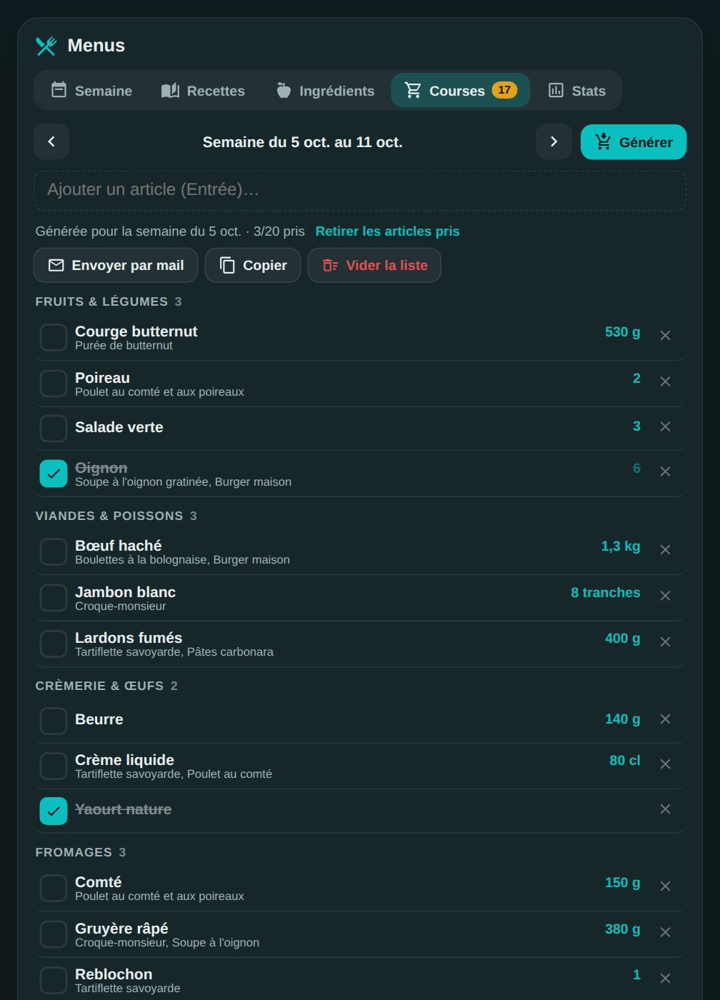 | 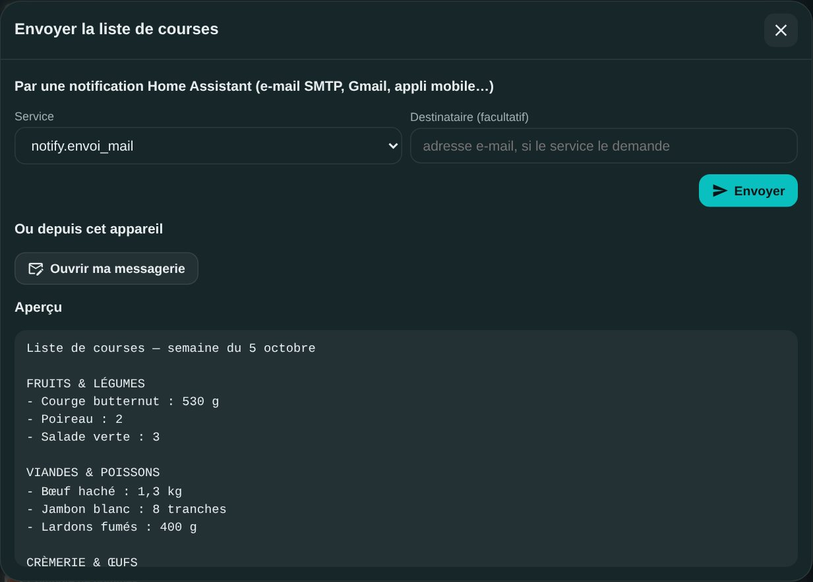 |

- Choisissez la semaine et touchez **Générer** : les ingrédients des repas prévus sont mis à l'échelle du nombre de personnes, additionnés et rangés par rayon.
- Les articles déjà cochés et ceux ajoutés à la main sont conservés quand vous régénérez la liste.
- **Envoyer par mail** ouvre la fenêtre d'envoi :
  - un **carnet d'adresses** (Marie, Paul, Léa…) : cochez les personnes, ajoutez-en ou retirez-en ; vos choix sont retenus pour la fois suivante ;
  - **un seul e-mail** part vers toutes les adresses cochées, mis en forme par rayon avec une case à cocher par article. Il utilise les réglages de votre intégration **SMTP** de Home Assistant (serveur, identifiants, expéditeur) : rien à ressaisir, et aucune adresse à déclarer comme destinataire SMTP ;
  - les **téléphones et tablettes** (entités de notification) peuvent aussi être cochés : ils reçoivent la liste en notification ;
  - **Ouvrir ma messagerie** prépare le même message dans la messagerie de l'appareil, avec les adresses cochées.
- Les articles similaires sont regroupés pour l'affichage, sans perdre les entrées d'origine : par exemple **œuf/œufs**, **lardon/lardons/lardon nature ou fumé** et **beurre/beurre doux**. Les quantités compatibles sont additionnées.
- Vous pouvez **personnaliser les catégories**, modifier ou retirer un article de la liste sans supprimer l'ingrédient de sa recette, et **exclure des articles pour une semaine** puis les restaurer individuellement ou tous ensemble.
- L’envoi **Telegram** propose une liste interactive, synchronisée avec les cases à cocher dans HOLM. Le message conserve les rayons, les quantités et les dates de la semaine de courses. Les longues listes sont réparties en plusieurs messages ; les boutons agissent sur tous les articles regroupés et les messages existants sont actualisés lorsque la liste change.
- **Copier** met la liste dans le presse-papiers. **Vider la liste** repart de zéro.

---

## Export vers un calendrier

Le planning HOLM peut être **exporté manuellement** vers un calendrier déjà configuré dans Home Assistant : un calendrier local, **Google Calendar** ou un calendrier distant **CalDAV**. HOLM utilise l'entité `calendar.*` fournie par l'intégration de calendrier ; il ne demande pas de compte Google ni d'identifiants CalDAV supplémentaires.

### Préparer le calendrier

1. Ajoutez l'intégration correspondant à votre calendrier : [**Local Calendar**](https://www.home-assistant.io/integrations/local_calendar/), [**Google Calendar**](https://www.home-assistant.io/integrations/google/) ou [**CalDAV**](https://www.home-assistant.io/integrations/caldav/).
2. Vérifiez que le calendrier cible apparaît comme entité `calendar.*` dans Home Assistant et qu'il autorise la création d'événements.
3. Dans HOLM My Menu, ouvrez le planning et la fonction d'**export calendrier**. Choisissez le calendrier de destination, la période et, si souhaité, un préfixe pour les titres.

### Fonctionnement de l'export

- HOLM crée **un événement par repas** (midi ou soir) contenant les recettes prévues et, lorsqu'elles existent, leurs URL d'origine.
- Horaires actuels : **12 h–13 h** pour le midi et **19 h–20 h** pour le soir, dans le fuseau horaire de Home Assistant.
- La période sélectionnée peut couvrir **32 jours maximum**.
- **Ajouter les événements manquants** : conserve les événements HOLM déjà présents et n'ajoute que ceux qui manquent.
- **Synchroniser** : crée les événements absents, met à jour ceux qui ont changé et peut supprimer les événements HOLM devenus inutiles, **uniquement après confirmation**.
- Les événements créés portent un identifiant HOLM dans leur description : la synchronisation n'altère pas les autres rendez-vous du calendrier.

> La mise à jour et la suppression dépendent des fonctionnalités prises en charge par l'intégration du calendrier choisi. Si elles sont indisponibles, HOLM signale l'impossibilité de synchroniser au lieu de recréer les événements en double. L'export est **déclenché par l'utilisateur**, ce n'est pas une synchronisation automatique permanente ni une importation bidirectionnelle des rendez-vous.

---

## Rappels et notifications

HOLM permet de programmer des rappels pour **faire les courses**, **consulter les menus**, **préparer une recette** ou envoyer un **message personnalisé** (par exemple « Acheter les pommes de terre à la ferme »).

- **Fréquence** : une seule fois (date précise), chaque jour ou chaque semaine, avec choix de l’heure et, pour les rappels hebdomadaires, des jours. Les horaires utilisent le fuseau horaire de Home Assistant.
- **Canaux** : notification Home Assistant sur téléphone, Telegram (chat ou sujet) et e-mail via SMTP. Plusieurs destinataires peuvent être sélectionnés.
- **Courses** : le rappel et les messages envoyés mentionnent la période correspondant à la liste sélectionnée.
- **Gestion** : création, modification, suppression et test d’un rappel depuis l’interface HOLM.
- **Déclenchement** : vérification toutes les 30 secondes ; un rappel programmé n’est envoyé qu’une fois par minute prévue, y compris après redémarrage. En cas d’échec, le statut indique l’erreur mais l’envoi n’est pas automatiquement retenté pendant cette minute.
- **Condition « uniquement si nécessaire »** : pour les courses, pas de rappel si aucun article n’est en attente ; pour le planning, pas de rappel si tous les repas des sept prochains jours sont prévus. Les rappels de préparation restent des consignes saisies manuellement.
- **Telegram** : les rappels sont des messages distincts de la liste de courses interactive. Un sujet de supergroupe peut être ciblé avec son identifiant de fil.

Les paramètres des canaux sont ceux des intégrations [SMTP](https://www.home-assistant.io/integrations/smtp/), [Telegram Bot](https://www.home-assistant.io/integrations/telegram_bot/) et [Mobile App](https://www.home-assistant.io/integrations/mobile_app/) de Home Assistant : HOLM ne stocke pas de mot de passe SMTP ni de jeton Telegram supplémentaire.

---

## Statistiques

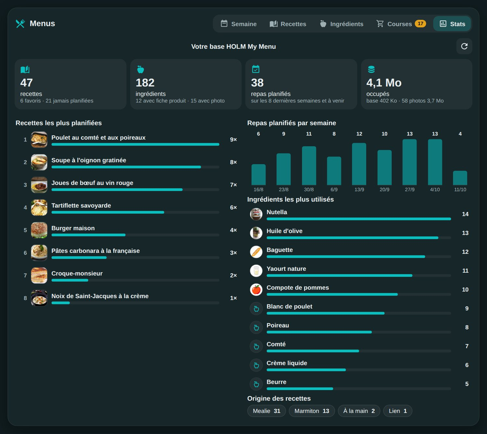

L'onglet **Stats** (ou une carte dédiée avec `view: stats`) montre :

- les chiffres clés : recettes (favorites, jamais planifiées), ingrédients (avec fiche produit, avec photo), repas planifiés, place occupée par la base et les photos ;
- les **recettes les plus planifiées**, avec le nombre de fois et la dernière date ; un toucher ouvre la recette ;
- les **ingrédients les plus utilisés** (selon les recettes planifiées) ;
- les **repas planifiés par semaine** sur les 8 dernières semaines ;
- l'origine des recettes (Marmiton, Jow, Mealie, lien, revisitée, à la main).

Le compteur est conservé indéfiniment, même quand l'historique du planning est nettoyé.

```yaml
type: custom:holm-mymenu-card
view: stats
title: Nos habitudes
```

---

## Capteurs

| Entité | État | Attributs |
|---|---|---|
| `sensor.holm_mymenu_midi` | menu du midi | `date`, `slot`, `recipes` (nom, durée, portions), `entries` |
| `sensor.holm_mymenu_soir` | menu du soir | idem |
| `sensor.holm_mymenu_next` | prochain repas prévu | idem |

L'image de l'entité est la photo de la recette. Exemple : annoncer le menu du soir sur l'enceinte de la cuisine.

```yaml
automation:
  - alias: Annonce du menu du soir
    triggers:
      - trigger: time
        at: "18:30:00"
    conditions:
      - condition: not
        conditions:
          - condition: state
            entity_id: sensor.holm_mymenu_soir
            state: Rien de prévu
    actions:
      - action: tts.speak
        target:
          entity_id: tts.google_translate_fr_fr
        data:
          media_player_entity_id: media_player.cuisine
          message: "Ce soir au menu : {{ states('sensor.holm_mymenu_soir') }}"
```

---

## FAQ / dépannage

**« Custom element doesn't exist: holm-mymenu-card ».**
Vérifiez dans *Paramètres → Tableaux de bord → ⋮ → Ressources* que `/holm_mymenu_static/holm-mymenu-card.js` est présent (l'intégration l'ajoute au démarrage ; en mode YAML, ajoutez-le vous-même en type *module*). Puis rechargez avec **Ctrl + Maj + R**. Dans l'application mobile : Paramètres → Application compagnon → Débogage → **Réinitialiser le cache du frontend**.

**La recherche Open Food Facts ne répond pas.**
Open Food Facts est un service gratuit, parfois saturé. Réessayez un peu plus tard. Vous pouvez aussi ajouter l'ingrédient sans produit et l'associer plus tard depuis sa fiche.

**Une recette Marmiton ne s'importe pas.**
Marmiton peut changer sa page. Essayez l'import par **Lien** ; sinon, ouvrez une issue avec l'adresse de la recette.

**La recherche Jow ne répond plus.**
Jow n'a pas d'API officielle et peut changer la sienne sans prévenir (voir [Recettes Jow](#recettes-jow)). Essayez l'import par **Lien** avec l'adresse d'une recette jow.fr, et ouvrez une issue : la recherche sera adaptée.

**L'export calendrier refuse une mise à jour ou une suppression.**
Le calendrier cible doit permettre l'opération demandée. Essayez le mode d'ajout des événements manquants ou vérifiez les droits du calendrier dans Home Assistant. La suppression d'anciens événements HOLM exige une confirmation explicite.

**Un PDF scanné ne s’importe pas.**
HOLM lit les PDF qui contiennent du texte exploitable. L’OCR a été retiré : convertissez d’abord le scan en PDF avec texte sélectionnable. Vérifiez également les limites de **8 Mo et 15 pages**, puis contrôlez le brouillon de recette avant enregistrement.

**Telegram n'envoie pas la liste ou les boutons ne répondent pas.**
Vérifiez l'intégration [Telegram Bot](https://www.home-assistant.io/integrations/telegram_bot/), les chats autorisés, les droits du bot dans le groupe et, le cas échéant, l'identifiant du sujet. Le service `telegram_bot.send_message` doit être disponible.

**L'envoi par e-mail échoue.**
L'envoi utilise l'intégration **SMTP** de Home Assistant : vérifiez qu'elle est configurée et qu'elle fonctionne. Pour Gmail, il faut un *mot de passe d'application*. Sans intégration SMTP, utilisez « Ouvrir ma messagerie ».

**Le scanner ne s'ouvre pas.**
Le navigateur doit avoir l'autorisation d'utiliser la caméra, et Home Assistant doit être ouvert en HTTPS. Sinon, *Photographier le code* ou tapez son numéro.

**Mobile : à la première photo, l'application revient à l'accueil de Home Assistant.**
C'est l'application Home Assistant qui se recharge après la demande d'autorisation de la caméra. Choisissez « Pendant l'utilisation de l'application » : la question ne revient plus, et il suffit de rouvrir la page des menus cette fois-là.

**Mealie : « Jeton Mealie refusé ».**
Créez un nouveau jeton dans Mealie (Profil → Jetons d'API) et collez-le dans les options de l'intégration.

**Les photos sont-elles stockées chez moi ?**
Oui. Les photos des recettes et des produits sont copiées dans `www/holm_mymenu/` : la carte ne dépend pas de sites extérieurs pour les afficher.

---

## Un petit merci ?

HOLM My Menu vous fait gagner du temps chaque semaine ? Vous pouvez m'offrir une bière 🍺

[](https://paypal.me/kaaribou)

---

## Crédits & licence

- Données produits : [Open Food Facts](https://fr.openfoodfacts.org) (licence ODbL).
- Recettes : [Marmiton](https://www.marmiton.org), [Jow](https://jow.fr) (non affilié, interface non officielle) et les sites d'origine, pour votre usage personnel ; [Mealie](https://mealie.io) pour l'import et l'export.
- Code : licence **MIT** — © kaaribou.

Voir le [CHANGELOG](CHANGELOG.md).

Fait partie de **HOLM — Home Orchestration & Living Management** : la gestion et l'orchestration intelligente de la maison.

Les autres projets : [Volets HOLM](https://github.com/kaaribou/volets-holm) · [Climat HOLM](https://github.com/kaaribou/climat-holm) · [Carburant HOLM](https://github.com/kaaribou/carburant-holm) · [Commandes à la maison HOLM](https://github.com/kaaribou/commandes-holm) · [HOLM LaMetric](https://github.com/kaaribou/lametric-holm) · [HOLM Navbar Card](https://github.com/kaaribou/holm-navbar-card) · [HOLM Climate Card](https://github.com/kaaribou/climate-card-holm) · [HOLM Music Card](https://github.com/kaaribou/holm-music-card) · [HOLM Sentinel Card](https://github.com/kaaribou/holm-sentinel-card) · [HOLM Security Card](https://github.com/kaaribou/holm-security-card) · [HOLM Recordings Card](https://github.com/kaaribou/holm-recordings-card) · [HOLM Covers Card](https://github.com/kaaribou/holm-covers-card) · [HOLM Power Flow Card](https://github.com/kaaribou/holm-power-flow-card) · [HOLM Energy Cards](https://github.com/kaaribou/holm-energy-cards) · [HOLM Radiator Card](https://github.com/kaaribou/holm-radiator-card) · [HOLM Floor Card](https://github.com/kaaribou/holm-floor-card) · [HOLM Ecojoko Card](https://github.com/kaaribou/holm-ecojoko-card) · [HOLM Smoke Card](https://github.com/kaaribou/holm-smoke-card) · [HOLM BG Card](https://github.com/kaaribou/holm-bg-card).
